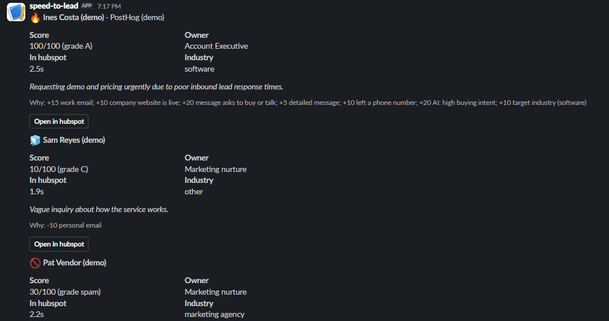
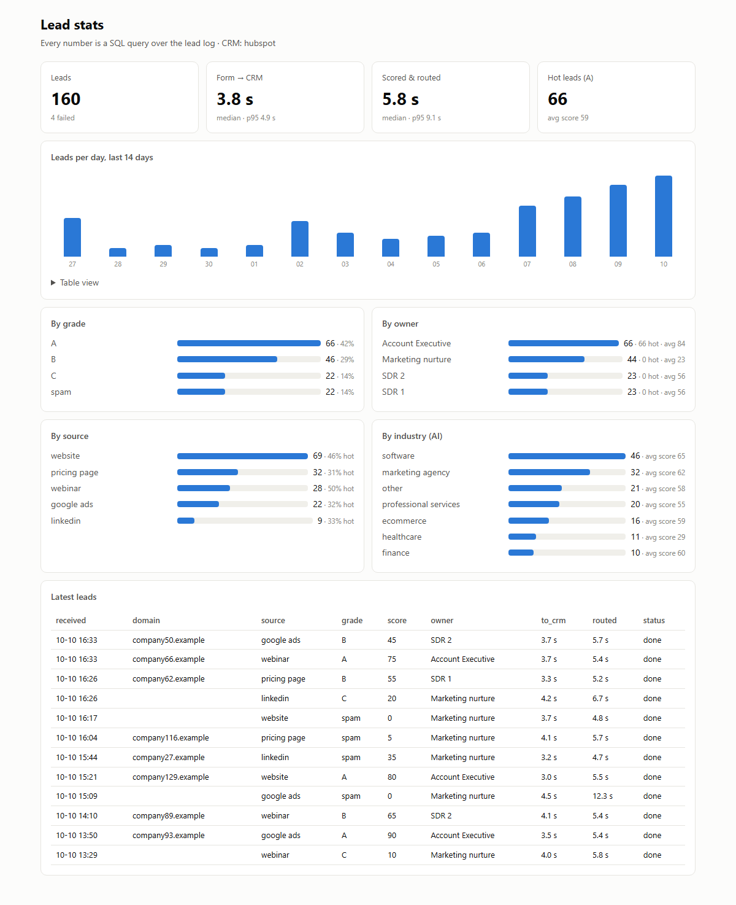

# speed-to-lead

**A website form → HubSpot or Salesforce in about 4 seconds, then enriched, scored and routed to the right rep.**
Person, company, sales opportunity and the message, with no duplicates, automatic retries, a lead score with
its reasons, an owner, a Slack alert and a stats page.

Fast follow-up wins deals, yet many teams still copy form submissions into the CRM by hand, hours later,
and the best leads wait in the same queue as spam. This service does it the moment the form is sent.

```
Website form ──POST /leads──▶ speed-to-lead
   phase 1 (~4 s)  ──▶ HubSpot (Company · Contact · Deal · Note)  or  Salesforce (Account · Contact · Opportunity · Task)
   phase 2 (~5 s)  ──▶ read the company website ─▶ local AI (industry, intent) ─▶ score 0–100 with reasons
                       ─▶ routing rules (round-robin) ─▶ owner + score note in the CRM ─▶ Slack / Telegram alert
   /dashboard      ──▶ stats page: every number is a SQL query over the lead log
```

## Measured on real accounts (demo data, Oct 2026)

| CRM | Form → CRM fully written |
|---|---|
| HubSpot | median **3.9 s** |
| Salesforce | median **5.7 s** |

## Enrich, score, route (v2)

Run on the real HubSpot account with a local AI model (Ollama, `qwen3:8b`), Oct 2026. Scoring times are with the
model already loaded; a cold start (model loading into memory) adds ~15 s once, the CRM write is unaffected:

| Demo lead | In HubSpot | Scored and routed | Result |
|---|---|---|---|
| Work email, company site live, "demo and pricing this week" | 3.9 s | 5.6 s | **100 (A)** → Account Executive |
| Gmail, "just curious how this works" | 2.0 s | 3.6 s | **10 (C)** → marketing nurture |
| "We offer SEO services and backlinks…" | 2.8 s | 4.7 s | **spam** → marketing nurture |
| Same person as the first, follow-up | 2.3 s (contact and company reused) | 4.6 s | **75 (A)** → Account Executive |

What the rep sees on the deal, as a HubSpot note:

```
Lead score 100/100 (grade A) → routed to Account Executive (rule 2)
Why: +15 work email; +10 company website is live; +20 message asks to buy or talk; +5 detailed message;
     +10 left a phone number; +20 AI: high buying intent; +10 target industry (software)
Website: PostHog automatically diagnoses problems, fixes bugs, and generates pull requests…
AI: software · product analytics platform · intent high. Requesting demo and pricing urgently…
```



- **Score = rules + AI.** Points a sales manager can read and change, not a black box. The AI adds industry and
  intent; the rules have the last word. The SEO pitch above was rated "medium intent" by the AI and still flagged
  as spam by the rules.
- **Routing** is a JSON file of rules (`routing.example.json`): first match wins; a list of owners is shared
  round-robin, with the turn kept in SQLite so a restart doesn't reset it. Owners can carry a HubSpot owner id,
  a Salesforce user id and a Slack mention.
- **The CRM write comes first.** Enrichment, AI and scoring run after the lead is saved; if any of them fails,
  the lead is still in the CRM and the rep still gets an alert ("not scored, see log").
- **AI runs locally by default** (Ollama): free, and lead data never leaves the machine. Any OpenAI-compatible
  API works too (`LLM_BASE_URL`). If the AI is down, the rules still score the lead.

### Stats page

`GET /dashboard` (browser login; password = the webhook secret). Plain SQL over the lead log: medians and p95
with window functions, a 14-day calendar from a recursive CTE, breakdowns by grade, owner, source and industry.
No chart library; works on a phone and in dark mode.



*Synthetic data from `scripts/seed_dashboard.py` (160 made-up leads, scored and routed by the real code).*

## What it handles

| Situation | Behaviour |
|---|---|
| New person | Creates company (by domain), contact, deal, note; links them |
| Same person writes again | Updates the contact, reuses the company, opens a new deal for the new enquiry |
| Form or webhook sends the same submission twice | Second copy ignored (idempotency key, atomic insert) |
| Gmail/Outlook address, no website | Contact without a company (no "gmail.com" company) |
| CRM rate limit or outage (429/5xx) | Retries with backoff, honours `Retry-After` |
| Bad data the CRM rejects | Fails fast, records the error, alerts the rep; no lead is lost silently |
| Salesforce token expires | Refreshes once and continues |

## Two bugs the real APIs taught me

1. **Duplicate companies in HubSpot.** HubSpot's search index lags a few seconds behind writes, and company domains
   aren't unique. Two leads from one company two seconds apart created two companies. Fix: a local domain → company
   record plus a lock; a test reproduces it. (Contacts were safe: HubSpot answers `409 Existing ID`, which the code uses.)
2. **Orphan records on rejected leads.** HubSpot rejected a test email domain after the company was already created.
   Fix: write the contact first, the step most likely to be rejected.

## Security

- Shared secret header required whenever a real CRM is configured (constant-time comparison); the app refuses to start without it.
- Lead details and stats need the same secret; `/health` reveals nothing.
- Per-IP rate limit, which also throttles secret guessing. Input lengths capped; emails validated.
- No interactive API docs in production. Tokens never logged. `.env` is git-ignored.
- **Website fetch can't be aimed at the inside network (SSRF):** the domain comes from a stranger's form, so only
  public addresses are fetched (no `localhost`, `10.x`, `169.254.169.254` cloud metadata), every redirect is
  re-checked, with a size cap and a 5 s timeout.
- **Prompt injection:** website text and the message are marked as untrusted data in the prompt, and the AI's
  answer is validated: only known industries and intents are accepted, free text is cut short.
- **Slack and the stats page escape form text,** so a name like `<!channel>` can't ping everyone and a
  `<script>` in a field is shown, not run.
- Least privilege: HubSpot key limited to contacts, companies and deals. For Salesforce, run the client-credentials
  app as a dedicated integration user in production.

## Design

- One sync flow (`crm/base.py`), one adapter per CRM (`crm/hubspot.py`, `crm/salesforce.py`), and an in-memory fake
  for tests and dry runs. Adding Pipedrive or Zoho means one new adapter.
- FastAPI answers the form in milliseconds (202) and writes to the CRM in the background.
- SQLite log of every lead: status, timings, CRM ids, errors, score, grade, owner. Older databases are upgraded
  in place on start.
- `enrich.py` (website), `llm.py` (AI), `qualify.py` (score + routing), `notify.py` (Slack Block Kit, Telegram),
  `dashboard.py` (SQL + HTML).

## Run it

```bash
python -m venv .venv && .venv/Scripts/pip install -e ".[dev]"   # Linux/macOS: .venv/bin/pip
cp .env.example .env        # choose CRM=hubspot|salesforce|dryrun, add keys and a WEBHOOK_SECRET
pytest -q                   # 55 tests, no network needed (APIs and the AI are mocked)
uvicorn speed_to_lead.app:main_app --factory --port 8000
python scripts/demo.py      # sends 4 demo leads and prints timings, scores and owners
python scripts/try_qualify.py         # score sample leads without any CRM
python scripts/seed_dashboard.py      # synthetic data for /dashboard (separate database)
```

Local AI: install [Ollama](https://ollama.com), `ollama pull qwen3:8b`, then set `LLM_BASE_URL`, `LLM_MODEL` and
`LLM_REASONING_EFFORT=none` as in `.env.example`.

HubSpot: a service key with `crm.objects.{contacts,companies,deals}.read/write`.
Salesforce: an External Client App with the OAuth client credentials flow and the `api` scope.

## Same flow in Zapier and Make

Also built on the free plans of Zapier (Google Forms → HubSpot → Slack) and Make (webhook → HubSpot → Slack),
with screenshots, the Make blueprint and when I'd pick each tool: [docs/no-code-versions.md](docs/no-code-versions.md).


## Why I built it

I've built this kind of flow in n8n before. For lead and money flows I prefer code: I learned test-driven development
in Ruby, and n8n has no way to test a workflow before it breaks in production. Built with Claude Code as a pair
programmer; design, debugging against the real APIs and tests are mine.
