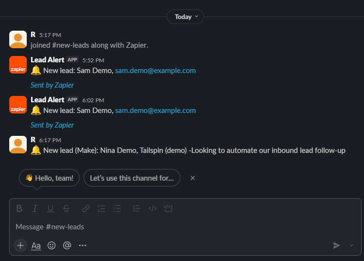

# speed-to-lead

**A website form → HubSpot or Salesforce in about 4 seconds.** Person, company, sales opportunity and the message,
with no duplicates, automatic retries and an alert to the sales rep.

Fast follow-up wins deals, yet many teams still copy form submissions into the CRM by hand, hours later.
This service does it the moment the form is sent.

```
Website form ──POST /leads──▶ speed-to-lead ──▶ HubSpot   (Company · Contact · Deal · Note)
                                   │        └─▶ Salesforce (Account · Contact · Opportunity · Task)
                                   └──▶ Telegram alert: "New lead in 3.9 s: Maya · Northwind"
```

## Measured on real accounts (demo data, Oct 2026)

| CRM | Form → CRM fully written |
|---|---|
| HubSpot | median **3.9 s** |
| Salesforce | median **5.7 s** |

## What it handles

| Situation | Behaviour |
|---|---|
| New person | Creates company (by domain), contact, deal, note; links them |
| Same person writes again | Updates the contact, reuses the company, opens a new deal for the new enquiry |
| Form or webhook sends the same submission twice | Second copy ignored (idempotency key, atomic insert) |
| Gmail/Outlook address, no website | Contact without a company (no "gmail.com" company) |
| CRM rate limit or outage (429/5xx) | Retries with backoff, honours `Retry-After` |
| Bad data the CRM rejects | Fails fast, records the error, alerts the rep; no lead is lost silently |
| Salesforce token expires | Refreshes once and continues |

## Two bugs the real APIs taught me

1. **Duplicate companies in HubSpot.** HubSpot's search index lags a few seconds behind writes, and company domains
   aren't unique. Two leads from one company two seconds apart created two companies. Fix: a local domain → company
   record plus a lock; a test reproduces it. (Contacts were safe: HubSpot answers `409 Existing ID`, which the code uses.)
2. **Orphan records on rejected leads.** HubSpot rejected a test email domain after the company was already created.
   Fix: write the contact first, the step most likely to be rejected.

## Security

- Shared secret header required whenever a real CRM is configured (constant-time comparison); the app refuses to start without it.
- Lead details and stats need the same secret; `/health` reveals nothing.
- Per-IP rate limit, which also throttles secret guessing. Input lengths capped; emails validated.
- No interactive API docs in production. Tokens never logged. `.env` is git-ignored.
- Least privilege: HubSpot key limited to contacts, companies and deals. For Salesforce, run the client-credentials
  app as a dedicated integration user in production.

## Design

- One sync flow (`crm/base.py`), one adapter per CRM (`crm/hubspot.py`, `crm/salesforce.py`), and an in-memory fake
  for tests and dry runs. Adding Pipedrive or Zoho means one new adapter.
- FastAPI answers the form in milliseconds (202) and writes to the CRM in the background.
- SQLite log of every lead: status, timings, CRM ids, errors.

## Run it

```bash
python -m venv .venv && .venv/Scripts/pip install -e ".[dev]"   # Linux/macOS: .venv/bin/pip
cp .env.example .env        # choose CRM=hubspot|salesforce|dryrun, add keys and a WEBHOOK_SECRET
pytest -q                   # 28 tests, no network needed (APIs are mocked)
uvicorn speed_to_lead.app:main_app --factory --port 8000
python scripts/demo.py      # sends 3 demo leads and prints the timings
```

HubSpot: a service key with `crm.objects.{contacts,companies,deals}.read/write`.
Salesforce: an External Client App with the OAuth client credentials flow and the `api` scope.

## Same flow in Zapier and Make

Also built on the free plans of Zapier (Google Forms → HubSpot → Slack) and Make (webhook → HubSpot → Slack),
with screenshots, the Make blueprint and when I'd pick each tool: [docs/no-code-versions.md](docs/no-code-versions.md).



## Why I built it

I've built this kind of flow in n8n before. For lead and money flows I prefer code: I learned test-driven development
in Ruby, and n8n has no way to test a workflow before it breaks in production. Built with Claude Code as a pair
programmer; design, debugging against the real APIs and tests are mine.
