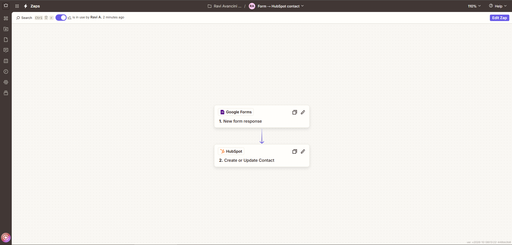
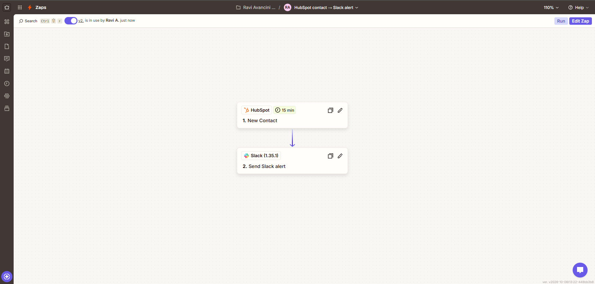
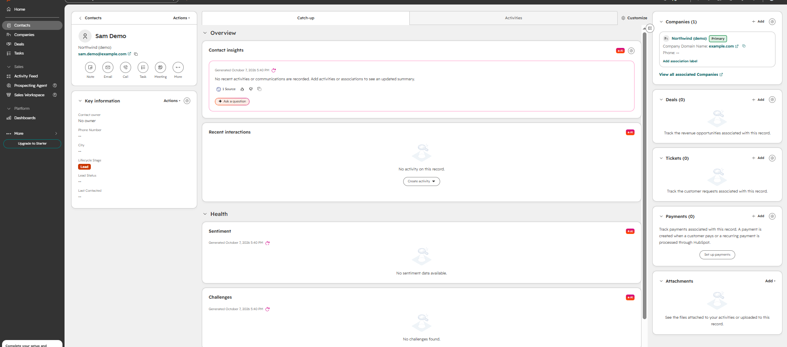
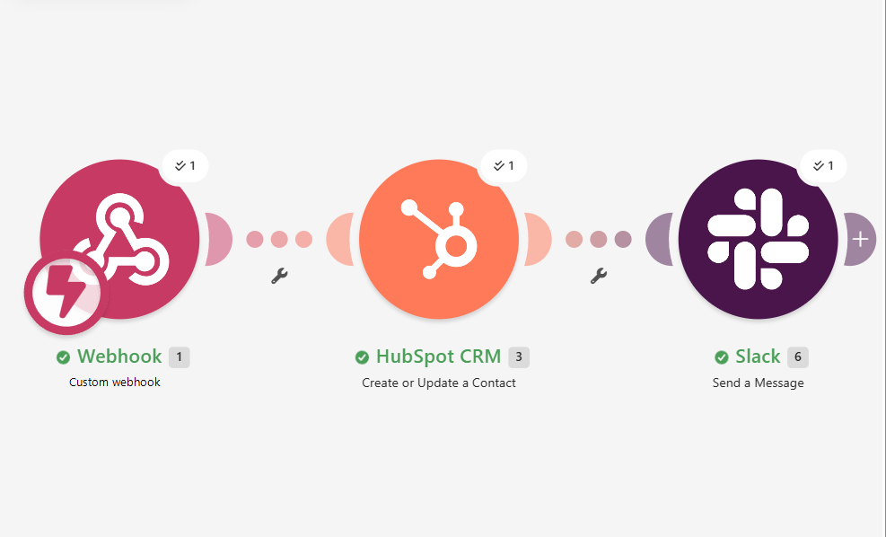

# The same lead flow in Zapier and Make

Built Oct 2026 on free plans, against the same HubSpot account and a demo Slack workspace (`#new-leads`), with demo data.

## Zapier: two 2-step Zaps (free plan)

The free plan has no webhook trigger and allows two steps per Zap, so the flow is split in two:

| Zap | Trigger | Action |
|---|---|---|
| Form → HubSpot contact | Google Forms: New Form Response | HubSpot: Create or Update Contact |
| HubSpot contact → Slack alert | HubSpot: New Contact (polls every 15 min) | Slack: Send Channel Message |

## Make: one scenario (free plan)

Custom webhook → HubSpot CRM: Create or Update a Contact → Slack: Send a Message.
Exported blueprint: [`make-blueprint.json`](make-blueprint.json) (no credentials inside; connections are references to the account).

## Result

## What I learned

- **HubSpot links contacts to companies by email domain on its own.** A contact with an `example.com` address was attached
  to the existing company with that domain, whatever the form said. The Python version dedupes companies by domain for the same reason.
- **Zapier drafts:** editing a live Zap creates a draft; the live version keeps running until you publish again.
- **HubSpot app governance** blocked Make from deals until an admin approves the scopes, so the Make version writes the
  contact only. The Python version writes company, contact, deal and note.
- **Polling vs push:** the Zapier free plan polls every 15 minutes; the Make webhook and the Python service react in seconds.

## When I'd pick which

| Tool | Pick it when |
|---|---|
| Zapier | A non-technical team will own it; simple, linear flows; widest app catalog |
| Make | Branching, iterators and data mapping on a budget; visual debugging per run |
| n8n | Self-hosting, custom code nodes, high volume without per-task pricing |
| Python service | Money or lead flows that need tests, idempotency, retries and exact timing (this repo) |
